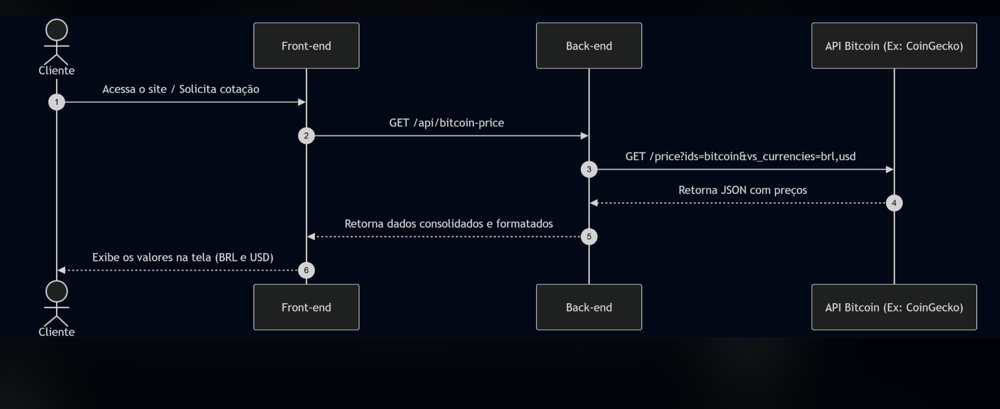
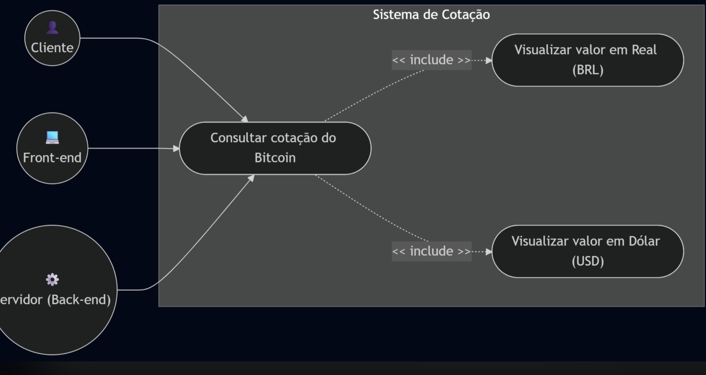

# Devlog: Predição de BTC-USD com Docker

Aqui eu mostrei as minhas decisões, etapas e dificuldades.

---

## Etapa 1: Arquitetura (UML)

### Por que começar pelo diagrama
Aqui eu lembrei de uma aula do Murillo onde foi explicado o papel dos diagramas UML:
eles servem para pensar a solução sem se prender a tecnologias e para encontrar erros
antes de escrever código.

### Referência: exemplo feito em aula
Nessa aula, uma colega (Isabel acho) fez em Mermaid os diagramas de um sistema de cotação do
Bitcoin, onde o cliente acessa um front-end, o back-end consulta uma API externa que no caso era CoinGecko, e
devolve o preço atual em BRL e USD.




*Diagramas aqui utilizados como referência.*

Usei esse exemplo como ponto de partida e adaptei para esta atividade, que é parecido, ele também tem uma predição:

| Exemplo de aula (cotação) | Esta atividade (predição) |
|---|---|
| O back-end busca o preço atual em uma API externa | O back-end usa um modelo treinado para prever o preço do dia seguinte |
| Não tem treino | Tem um container de treino que gera o artefato do modelo |
| Front-end para o usuário | Sem UI, o cliente é um `curl` no terminal |
| Mostra BRL e USD | Só USD |

### O que eu pensei para o diagrama
Algo simples, onde a pessoa faz um `curl` no terminal (sem UI) e uma API devolve o valor
do BTC em dólares para aquele dia.

### Como o diagrama final foi feito
Passei a minha ideia da arquitetura para a IA (Claude) e pedi um diagrama UML em Mermaid. A IA gerou dois
diagramas (componentes e sequência) e uma tabela de escolhas, em
[`docs/arquitetura.md`](docs/arquitetura.md). Diferente do exemplo de aula, o diagrama
final já cita tecnologias (Docker, FastAPI, joblib), porque ja tava em um nivel de detalhamento maior

Ajuste de uma ideia que eu tive:
Na primeira versão, o cliente enviava os últimos preços no corpo de um `POST /predict`.
Ao comparar com a minha ideia, percebi que:

- a API não devolve o preço real do dia, e sim uma previsão do fechamento do dia
  seguinte, feita a partir dos últimos N dias;
- enviar os preços deixaria o `curl` longo e seria necessário que o cliente enviasse os dados.

A partir disso eu tinha duas opções:

| Opção | Como funciona | Prós / contras |
|---|---|---|
| A | O cliente envia os últimos N fechamentos via `POST /predict` | Flexível, mas o comando é longo e o cliente precisa dos dados |
| **B (que eu escolhi)** | Cliente faz só `GET /predict`; a API usa os últimos N fechamentos salvos no `metadata.json` pelo treino | `curl` simples; a previsão fica presa ao fim do histórico |

Escolhi a **B** e o diagrama foi atualizado: 
```bash
curl localhost:8000/predict
# → {"date": "2026-10-05", "predicted_close_usd": 8xxxx.xx, "based_on_last_day": "2026-10-04"}
```
Minha explicação dos diagramas feitos na arquitetura.md:

O desenvolvedor roda `docker compose up`, que sobe dois containers. O primeiro, o trainer,
lê o CSV com o histórico do BTC, treina o modelo e salva o modelo treinado congelado no
arquivo `model.joblib`, dentro da pasta `models/`. Depois disso ele encerra. O segundo container, contém a
**API** que só sobe depois que o treino termina. Ela lê o `model.joblib` da mesma pasta
`models/`, que é compartilhada entre os dois containers. O usuário usa a aplicação pelo
terminal, com `curl`: `/health` para verificar se a API está no ar e `/predict` para pedir a
previsão. No `/predict`, a API pega os últimos 7 fechamentos, passa para o modelo e devolve a
previsão do dia seguinte em JSON.

**Minha opinião sobre as escolhas:**
As tecnologias eu teria escolhido as mesmas, por ter familiaridade com elas. A escolha da moeda e modelo foi minha (depois de uma comparação), e a questão do docker pela maior parte foi minha também. A parte do split, que foi feita em ordem cronológica foi inclusive uma escolha que fiz quando estava trabalhando com o modelo do projeto (depois descobri que era obrigatório)


---

## Etapa 2: Dados

### Como foi feito
Eu pedi para uma IA me gerar o CSV com os dados, ela escreveu o script `data/download_data.py`,
que baixa o histórico pela API pública da Binance, e rodou o script. Pensei em BTC com dolar porque acho interessante acompanhar o valor de criptomoedas

### Decisões
- **Moeda:** BTC cotado em dólar.
- **Frequência:** diária (um registro por dia).
- **Período:** de 01/01/2018 até o último dia já fechado. São quase 9 anos, com várias altas
  e quedas do BTC. Mais dados dão mais exemplos para o modelo aprender.
- **Horizonte da previsão:** fechamento do dia seguinte (D+1).

### Por que a Binance?
O repositório da atividade sugeriu algumas fontes. Na hora, a IA testou a Binance, ela funcionou e seguimos
com ela. A comparação abaixo foi feita depois, para registrar por que ela faz sentido:

| Fonte | Por que não / por que sim |
|---|---|
| Yahoo Finance / `yfinance` | Exige instalar biblioteca e às vezes bloqueia downloads automáticos |
| CryptoDataDownload / Kaggle | Download manual; a qualidade e o período variam |
| CoinGecko | O plano gratuito tem limites e pode exigir chave |
| **Binance (escolhida)** | API pública, sem chave e sem cadastro; testamos e funcionou na hora |

### Comando
```bash
python3 data/download_data.py
```

### Resultado
```
3200 candles baixados -> data/btc_usd.csv
```
O script baixou 3.200 dias, mas o CSV ficou com **3.199**. O último dia foi
descartado de propósito porque ainda não tinha fechado. A mensagem mostra o total antes desse filtro.

**Amostra do CSV (`data/btc_usd.csv`):**
```
Date,Open,High,Low,Close,Volume
2018-01-01,13715.65,13818.55,12750.00,13380.00,8609.91
2018-01-02,13382.16,15473.49,12890.02,14675.11,20078.09
...
2026-10-03,84518.00,85037.63,84456.02,84753.56,6889.63
2026-10-04,84753.57,86800.00,84719.99,86530.00,7993.11
```

| Coluna | Significado |
|---|---|
| `Date` | Dia |
| `Open` | Preço na abertura do dia (00:00 UTC) |
| `High` / `Low` | Maior e menor preço do dia |
| `Close` | Preço no fechamento do dia: foi a coluna utilizada pelo modelo|
| `Volume` | Quantidade de BTC negociada no dia |

**Validação dos dados:**
- Sem dias faltando: 3.199 dias seguidos, de 2018-01-01 a 2026-10-04.
- Menor fechamento: US$ 3.211,72 (15/12/2018). Maior: US$ 124.658,54 (06/10/2025).

### Observações
- A Binance negocia contra o USDT, uma stablecoin atrelada ao dólar (≈ 1 USD), então
  o preço equivale a BTC-USD, mas não é exatamente USD.
- O CSV fica salvo no repositório, então o treino não depende de internet.

---

## Etapa 3: Treino e exportação do modelo

**Arquivos:** `trainer/train.py`, `trainer/requirements.txt`, `trainer/Dockerfile`, `docker-compose.yml`

**Decisões:**
- **Modelo:** `LinearRegression` (scikit-learn), treinado em segundos e fácil de explicar.
- **Features:** fechamentos dos últimos 7 dias (`lag_1` = ontem ... `lag_7`). Alvo: fechamento do dia.
- **Split cronológico 80/20, sem embaralhar:** treino de 2018-01-08 a 2025-01-03, teste de
  2025-01-04 a 2026-10-04. O teste é sempre o período mais recente, para não vazar dados do futuro.
- **Baseline ingênuo:** "amanhã fecha igual a hoje". Serve de régua para ver se o modelo
  aprendeu algo além de repetir o último preço.
- **Versão final:** depois de avaliar, o modelo é retreinado com todos os dados antes de ser exportado.
- **Artefato:** `models/model.joblib` (modelo) e `models/metadata.json` (lags, métricas, data do
  treino e os **últimos 7 fechamentos**, que a API usa no `GET /predict`, como definido na opção B).
- **Volumes:** `./data` é montado como somente leitura e `./models` como gravação. O artefato
  aparece no host e fica disponível para o container da API.
- **Versões fixadas** (`scikit-learn==1.5.2`, `joblib==1.4.2`): a API precisa usar as mesmas
  versões, senão o `joblib.load` pode falhar ou dar aviso de incompatibilidade.

(aqui eu pedi uma comparação) Por que `LinearRegression` e não o Prophet (Meta)?

| Critério | LinearRegression (scikit-learn) | Prophet (Meta) |
|---|---|---|
| Para que foi feito | Regressão genérica; aqui usa os preços dos últimos 7 dias | Séries de negócio com sazonalidade forte (dia da semana, ano, feriados) e tendência |
| Encaixe com o BTC diário | O preço de amanhã depende muito do preço de hoje, e o modelo usa isso diretamente | A sazonalidade do BTC é fraca. O Prophet modela tendência e sazonalidade em função da data e não usa diretamente o preço de ontem, o que tende a prejudicar a previsão D+1 |
| Dependências e imagem Docker | Leve (`scikit-learn`, `pandas`) | Pesado (`prophet` + `cmdstanpy`/Stan), build mais lento e mais pontos de falha |
| Tempo de treino | Menos de 1 segundo | Segundos a minutos |
| Explicabilidade | Fácil: o coeficiente de cada lag mostra o peso de cada dia | Mais difícil: decomposição em tendência, sazonalidade e changepoints |
| Container de inferência | A API precisa só do scikit-learn | A API também teria que instalar o Prophet |
| O que o Prophet faz melhor | — | Intervalos de incerteza e horizontes longos (semanas ou meses) prontos |

**Conclusão:** porque eu tinha 100 minutos e o foco principal era na integração entre containers eu escolhi o modelo mais
leve e fácil de explicar, que usa diretamente a informação mais relevante para D+1 (os preços
recentes). Que eu achei fazer sentido, se tivesse mais tempo teria testado outros modelos.

**Comando:**
```bash
docker compose run --rm --build trainer
```

**Resultado:**
```
Dados: 3199 dias (2018-01-01 a 2026-10-04)
Treino: 2018-01-08 a 2025-01-03 (2553 linhas)
Teste:  2025-01-04 a 2026-10-04 (639 linhas)
Métricas no teste (USD): {"model": {"mae": 1394.77, "rmse": 1972.81}, "naive_baseline": {"mae": 1391.77, "rmse": 1968.3}}
Artefato salvo em models/model.joblib e models/metadata.json
```

**Análise das métricas:**
O modelo erra em média ~US$ 1.395 por dia (MAE), com o BTC na faixa de US$ 80 mil (erro de ~1,6%).
Ele empata com o baseline ingênuo, e fica até um pouco pior. Isso parece até fazer sentido. Porque o preço diário do BTC
se comporta quase como um passeio aleatório, e a regressão linear aprende essencialmente
amanhã ≈ hoje.

**Evidência: os pesos que o modelo aprendeu**
```bash
docker compose run --rm --no-deps trainer python -c "import joblib; m=joblib.load('models/model.joblib'); print(m.intercept_, m.coef_)"
```

| Feature | Peso |
|---|---|
| `lag_1` (ontem) | **0,9615** |
| `lag_2` | 0,0408 |
| `lag_3` a `lag_7` | entre -0,025 e 0,014 |
| intercepto | 46,98 |
| soma dos pesos | 0,9994 |

Quase todo o peso está em `lag_1`, e a soma dá ~1. Na prática, o modelo calcula
"previsão ≈ 96% do preço de ontem + pequenos ajustes", ou seja, ele parece copiar o último preço.
Os outros 6 dias quase não influenciam.

**Dificuldades:**
- O daemon do Docker não estava rodando (`Cannot connect to the Docker daemon`). Resolvi abrindo o Docker Desktop.


## Etapa 4: Backend de inferência

**Arquivos:** `api/app.py`, `api/requirements.txt`, `api/Dockerfile`, serviço `api` no `docker-compose.yml`
(Aqui eu também pedi ajuda para IA, na hora das escolhas)

### Como o backend foi feito

O desenho do backend das minhas decisões da Etapa 1:

1. O que o cliente precisa fazer? Só pedir a previsão com um `curl`, sem enviar dados
   (opção B). Por isso a rota é um `GET /predict`, sem corpo.
2. De onde vêm os dados de entrada? Do `metadata.json`, que o trainer salva junto com o
   modelo, com os últimos 7 fechamentos.
3. Como saber se o serviço está ativo? Com uma rota separada, `GET /health`, que o
   enunciado pede.

**Contrato da API:**

| Rota | Entrada | Saída (sucesso) | Erro |
|---|---|---|---|
| `GET /health` | nada | `{"status":"ok","model_loaded":true,"trained_at":"..."}` | — |
| `GET /predict` | nada | `{"date","predicted_close_usd","based_on_last_day","last_close_usd","disclaimer"}` | `503` se o modelo não estiver carregado |

**Fluxo dentro do `app.py`:**
```
Ao iniciar o container:
  lê models/model.joblib     → modelo na memória
  lê models/metadata.json    → últimos 7 fechamentos e data do último dia

A cada GET /predict:
  monta lag_1..lag_7 com os 7 fechamentos (lag_1 = último dia, mesma ordem do treino)
  model.predict(...)         → previsão
  devolve JSON com a data seguinte e o valor previsto
```

**Decisões (propostas pela IA):**
- **FastAPI + Uvicorn** na porta 8000: é Python (obrigatório) e gera a documentação em `/docs` automaticamente.
- **O modelo é carregado uma vez, na inicialização**, e não a cada requisição.
- **`/health` mostra se o modelo foi carregado**, não só se o servidor está de pé. Uma API no
  ar sem modelo não serve para nada, e esse campo deixa isso visível.
- **Se o modelo não existir**, `/predict` responde `503` com uma mensagem clara, em vez de quebrar.
- **A resposta inclui `last_close_usd`** (valor real do último dia), para comparar com a previsão.
- **Volume `./models` montado como somente leitura** na API: ela só consome o artefato, quem escreve é o trainer.
- **Mesmas versões de `scikit-learn`/`joblib` do trainer**, para o `joblib.load` funcionar sem incompatibilidade.
- **`depends_on` com `condition: service_completed_successfully`:** a API só sobe depois que o
  trainer termina com sucesso, ou seja, nunca sobe sem artefato.

### Testes do backend

Além do caminho normal (Etapa 5), a IA definiu e rodou os testes abaixo para ver como a API
se comporta em situações de erro. Eu revisei os resultados:

| # | Teste | Comando | Esperado | Resultado |
|---|---|---|---|---|
| 1 | API **sem modelo**: health | `curl -i localhost:8001/health` | 200, `model_loaded: false` | ✅ `200 OK` `{"status":"ok","model_loaded":false,"trained_at":null}` |
| 2 | API **sem modelo**: predict | `curl -i localhost:8001/predict` | 503 com mensagem | ✅ `503 Service Unavailable` `{"detail":"Modelo não carregado. Rode o trainer primeiro."}` |
| 3 | Rota que não existe | `curl -i localhost:8000/rota-inexistente` | 404 | ✅ `404 Not Found` |
| 4 | Método errado | `curl -i -X POST localhost:8000/predict` | 405 | ✅ `405 Method Not Allowed` |
| 5 | Duas chamadas seguidas | `curl localhost:8000/predict` (2x) | mesmo resultado | ✅ `86475.51` nas duas |
| 6 | API tenta escrever no volume | `docker compose exec api touch /app/models/teste` | bloqueado | ✅ `Read-only file system` |

Para os testes 1 e 2, subi a imagem da API sem montar o volume, ou seja, sem acesso ao
modelo, em outra porta:
```bash
docker run --rm -d -p 8001:8000 --name api-sem-modelo ponderada-murilo-api
# ...testes...
docker stop api-sem-modelo
```

O teste 5 confirma uma limitação conhecida: sem retreinar, a previsão é sempre a mesma.

## Etapa 5: Integração e testes

**Comando (treina e sobe a API):**
```bash
docker compose up --build -d
```

**Containers:** o trainer roda e encerra com `exit 0`, e a API fica no ar.
```
NAME                         SERVICE   STATUS                     PORTS
ponderada-murilo-api-1       api       Up 4 seconds               0.0.0.0:8000->8000/tcp
ponderada-murilo-trainer-1   trainer   Exited (0) 4 seconds ago
```

**Teste 1: health check**
```bash
curl localhost:8000/health
```
```json
{"status":"ok","model_loaded":true,"trained_at":"2026-10-05T17:39:26+00:00"}
```

**Teste 2: predição**
```bash
curl localhost:8000/predict
```
```json
{"date":"2026-10-05","predicted_close_usd":86475.51,"based_on_last_day":"2026-10-04","last_close_usd":86530.0,"disclaimer":"Previsão experimental, não é recomendação de investimento."}
```

**Logs da API (a requisição chegou ao backend):**
```
api-1  | INFO:     Uvicorn running on http://0.0.0.0:8000 (Press CTRL+C to quit)
api-1  | INFO:     172.18.0.1:57268 - "GET /health HTTP/1.1" 200 OK
api-1  | INFO:     172.18.0.1:57276 - "GET /predict HTTP/1.1" 200 OK
```

**Análise:** o modelo prevê US$ 86.475,51 para 05/10/2026, muito próximo do último fechamento
(US$ 86.530,00). Isso é coerente com o que vimos no treino: a regressão aprendeu basicamente
"amanhã ≈ hoje".

O Swagger gerado pelo FastAPI também fica disponível em `http://localhost:8000/docs`.

**Para encerrar:** `docker compose down`

## Dúvidas e dificuldades durante o desenvolvimento

### "O curl devolve o valor do BTC no dia? A atividade não pedia uma predição?"

Depois do primeiro teste, eu fiquei em dúvida se a API estava devolvendo o preço real ou uma
previsão. Concluí que é uma previsão. O CSV ia até 04/10/2026, o valor de 05/10 não existe nos dados. Na resposta, `predicted_close_usd` (86.475,51) vem do modelo. O único valor real é o `last_close_usd` (86.530,00), que é o fechamento de 04/10, incluído para comparação.

Por que parecia o valor do dia: como os dados acabavam ontem, o "dia seguinte" cai
 hoje. Além disso, a previsão fica muito perto do último preço, porque o modelo
aprendeu basicamente "amanhã ≈ hoje" (ver a Etapa 3).

## Como reproduzir do zero

```bash
python3 data/download_data.py  
docker compose up --build -d    
curl localhost:8000/health
curl localhost:8000/predict
docker compose down
```

## Limitações conhecidas

- A previsão é sempre do dia seguinte ao último dia do CSV; para atualizar, é preciso
  baixar os dados de novo e retreinar.
- Os dados são BTC/USDT, não USD exato.
- O modelo (regressão linear com 7 lags) não supera o baseline "amanhã = hoje" no teste.
- As predições são experimentais e não são recomendação de investimento.
