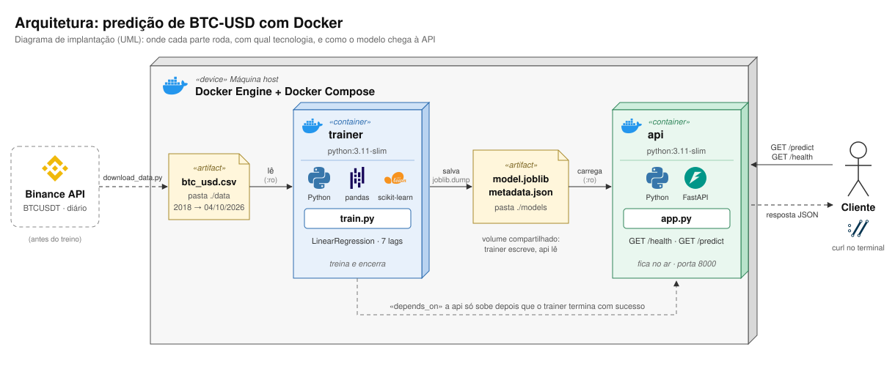
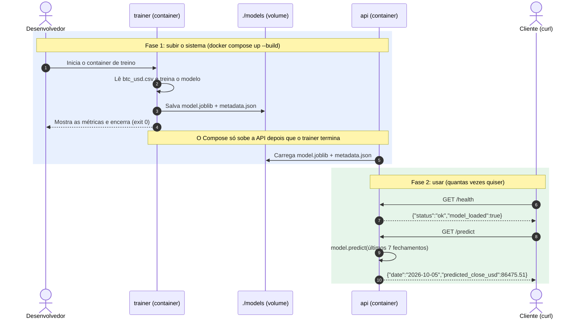

# Arquitetura da solução

## 1. Implantação: onde cada parte roda e com qual tecnologia

Diagrama de implantação da UML: as caixas 3D são **nós** (a máquina e os containers) e os
documentos com a ponta dobrada são **artefatos** (arquivos).

**Como o modelo chega ao container de inferência:** os dois containers montam a mesma pasta
`./models` do host como volume. O `trainer` salva `model.joblib` + `metadata.json` nela, e a
`api` lê esses arquivos ao iniciar (montagem somente leitura, `:ro`).

## 2. Sequência: o que acontece, em ordem

## 3. Escolhas do diagrama

| Decisão | Escolha | Justificativa |
|---|---|---|
| **Moeda / frequência / horizonte** | BTC-USD, diário, para o fechamento do dia seguinte (D+1) | Caso simples e facil para testar. |
| **Fonte de dados** | CSV gerado da API pública da Binance (par BTCUSDT) em `data/` | Evita dependência de API e internet na hora do treino, o que deixa o processo reproduzível. |
| **Ambiente de treino** | Container `trainer` separado | Isola as dependências de treino das de inferência. |
| **Modelo** | Regressão (scikit-learn) com features de *lags* dos fechamentos anteriores | Leve, treina em segundos.|
| **Split** | Cronológico (ex.: 80% treino / 20% teste), sem embaralhar | Embaralhar uma série temporal vaza dados do futuro para o treino. |
| **Formato do artefato** | `model.joblib` + `metadata.json` (nº de lags, data do treino, métricas e ultimos N fechamentos) | `joblib` é o padrão do scikit-learn. O metadata leva junto os dados de entrada que a API precisa para prever sem que o cliente envie nada. |
| **Como o modelo chega à inferência** | **Volume compartilhado** (`./models` montado nos dois containers) | O trainer escreve e a API lê. Retreinar não exige rebuild da imagem da API, basta reiniciar o container. |
| **Backend** | FastAPI + Uvicorn, porta 8000 | Python (obrigatório), validação com Pydantic e Swagger automático em `/docs`, útil na demonstração. |
| **Endpoints** | `GET /health` e `GET /predict` (sem corpo) | `/health` verifica se o serviço está ativo; `/predict` devolve a previsão do fechamento do dia seguinte ao fim do histórico. |
| **Orquestração** | `docker-compose.yml` com serviços `trainer` e `api`; a `api` depende do `trainer` terminar com sucesso | Um único `docker compose up --build` treina e depois sobe a API. A API nunca sobe sem artefato. |
| **Cliente** | `curl` no terminal, sem UI | Ideia inicial: uma pessoa faz um `curl` simples e recebe o valor previsto do BTC em dólares. O foco é a integração, não uma interface. |

**Limitações na arquitetura:**
- O modelo é estático: a API não retreina sozinha, é preciso rodar o `trainer` de novo.
- A previsão é sempre do dia seguinte ao último dia do CSV. Para prever um dia mais recente é preciso rodar `data/download_data.py` e retreinar.
- A API não busca dados ao vivo: até o próximo retreino, `GET /predict` devolve sempre o mesmo valor.
- O bind mount funciona localmente; em produção o artefato iria para um registry de modelos ou bucket (S3, MLflow).
- Os dados são BTC/USDT (stablecoin ≈ 1 USD), não USD exato.
